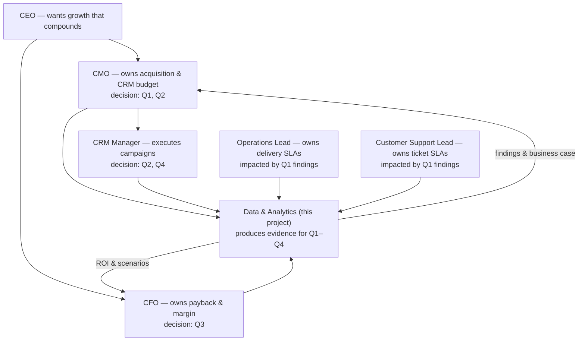
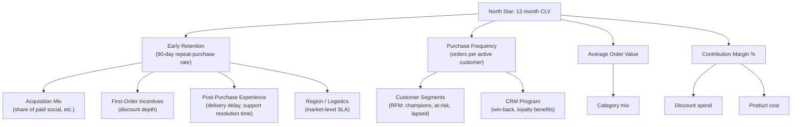

# 01 — Problem Framing: Repeat-Purchase Decline at Altiplano Goods

> **Fictitious case study.** Altiplano Goods is an invented Latin American online store (home & lifestyle).
> All data in this repository is synthetic and generated by `src/generate_data.py`. Nothing here describes a real company.

## 1. Problem statement

Altiplano Goods is a D2C e-commerce retailer (home & lifestyle) operating in six Latin American markets
(Chile, Peru, Colombia, Mexico, Argentina, Brazil). Between January 2024 and December 2025 the
**90-day repeat-purchase rate** — the share of new customers who place a second order within 90 days of
their first — fell from **~34% to ~27%** while acquisition spend kept growing.

The CMO and CFO have raised the same question from two angles:

- **CMO:** growth is leaking. We acquire more customers every quarter, but fewer of them come back.
- **CFO:** if repeat buyers carry the unit economics, a 7-point drop in early repeat signals a
  deteriorating payback on acquisition spend and a weakening customer asset.

**Decision to support:** whether to fund a loyalty / win-back program in 2026, and if so, where to
point it first.

### The four questions we must answer

| # | Question | Owner of the decision |
|---|----------|-----------------------|
| Q1 | *Why* is the 90-day repeat rate falling? | CMO |
| Q2 | *Which* customers should we act on (and which should we not)? | CMO / CRM lead |
| Q3 | Would a loyalty / win-back program *pay off*? | CFO |
| Q4 | What should we do *first*? | Leadership team |

## 2. Stakeholder map

## 3. KPI tree

North-star: **Customer Lifetime Value (12-month CLV)**.

Driver hypotheses to test with data (from the KPI tree, edition 2024–2025):

| # | Hypothesis | Measurable as |
|---|------------|---------------|
| H1 | Acquisition mix shifted toward paid social, whose customers repeat less | 90-day repeat by first-order channel, mix over time |
| H2 | Deeper first-order discounts attract deal-seekers who churn | 90-day repeat by discount band, discount mix over time |
| H3 | A delivery-delay problem in one region hurt repeat purchases | repeat vs. first-order delivery delay, by region and half-year |
| H4 | Bad support experiences (slow resolution) increase churn | repeat by first-ticket resolution-time bucket |

## 4. Success metrics for this project

The project itself is an analysis deliverable; success is measured by whether decisions can be made from it.

| Metric | Target |
|--------|--------|
| Questions Q1–Q4 answered with quantified evidence | 4/4 |
| Business case with scenarios, ROI and payback | 3 scenarios, sensitivity table |
| Prioritized initiatives (RICE) with user stories for top 3 | ≥ 6 stories, 3 with Gherkin ACs |
| Pipeline reproducibility | `make all` rebuilds everything from a single seed |
| Model usefulness | churn model test AUC reported with honest limitations |

## 5. Assumptions

1. **Data is synthetic but realistic**: 24 months (2024-01 → 2025-12), ~20k customers, ~80k orders,
   with injected data-quality issues (~2–3% of rows) that the pipeline must clean.
2. Business premise — 90-day repeat fell from ~34% (early 2024 cohorts) to ~27% (late-2025 cohorts) —
   is *the problem definition*, and the generator encodes plausible causal mechanisms (H1–H4);
   findings in this repo are rediscovered **from the data**, not assumed.
3. Repeat = second order within 90 days of the first order; cohorts observed before ~Oct 2025 have a
   full 90-day window (later cohorts are censored and excluded from headline trends).
4. Margin = product price − product cost (gross margin). No fixed-cost allocation; logistics cost is
   approximated as a per-order shipping cost in the business case assumptions.
5. A/B test results are simulated with a seeded process; z-test, CI, MDE and sample-size math are real.
6. Currency: USD (simplified for a portfolio case; a real LatAm case would be multi-currency).

## 6. Scope

**In scope**
- Data quality assessment and cleaning (raw → staging → marts)
- Cohort retention, repeat-rate driver analysis (channel, region, discount, delivery, support)
- RFM segmentation with a recommended action per segment
- A repeat-purchase (churn) driver model — logistic regression with business-readable odds ratios
- Simulated win-back A/B test with MDE / sample-size analysis
- Business case with 3 scenarios, ROI, payback, sensitivity
- Dashboard, executive summary, RICE roadmap, user stories

**Out of scope**
- Recommendations about pricing strategy beyond first-order discount policy
- Paid-media attribution beyond first-touch channel
- Inventory / assortment optimization
- Real (non-synthetic) customer data or PII

## 7. Deliverable map

| Question | Evidence artifact |
|----------|-------------------|
| Q1 why | `docs/04-sql-findings.md`, `docs/05-analytics.md` (model) |
| Q2 who | `docs/05-analytics.md` (RFM segments + actions) |
| Q3 payoff | `outputs/business_case/business_case.xlsx`, `docs/06-business-case.md` |
| Q4 what first | `docs/07-roadmap.md` (RICE), `docs/08-user-stories.md` |
| All | `docs/dashboard.html`, `docs/executive-summary.md` |
