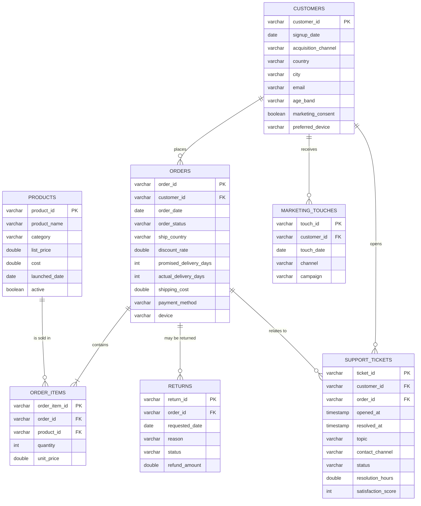

# 02 — Data Model & Data Dictionary

> All data is **synthetic** (generated by `src/generate_data.py`, seed 42).
> Layered model in DuckDB: `raw_*` (as-landed) → `stg_*` (cleaned) → marts.

## 1. Entity-relationship diagram (raw layer)

## 2. Pipeline layers

| Layer | Objects | Purpose |
|---|---|---|
| Raw | `raw_products`, `raw_customers`, `raw_orders`, `raw_order_items`, `raw_marketing_touches`, `raw_support_tickets`, `raw_returns` | CSV loaded as-is, no transformation |
| Staging | `stg_*` | Cleaned, deduplicated, canonical (`sql/10_staging.sql`), verified by `dq_findings` |
| Marts | `dim_customer`, `fct_orders`, `fct_order_items`, `mart_customer_orders`, `mart_cohort_retention`, `mart_rfm` | Analysis-ready (`sql/20_marts.sql`) |

## 3. Data dictionary — staging tables

`stg_` tables share the raw schema, with the following cleaning semantics:

| Table | Column | Type | Notes / rule |
|---|---|---|---|
| stg_customers | country | varchar | canonical (`Mexico, Brazil, Colombia, Chile, Peru, Argentina`, `Unknown`) |
| stg_customers | signup_date | date | null rows dropped (41) |
| stg_customers | customer_id | varchar | duplicates removed (80) |
| stg_orders | order_date | date | rows after `2025-12-31` dropped |
| stg_orders | ship_country | varchar | canonicalized like customers.country |
| stg_orders | discount_rate | double | null → `0.0` |
| stg_orders | shipping_cost | double | negative → `0.0` |
| stg_order_items | quantity / unit_price | int / double | `<= 0` rows dropped (returns live in the returns table) |
| stg_marketing_touches | channel | varchar | lowercase, null → `unknown` |
| stg_support_tickets | resolution_hours | double | recomputed from `resolved_at − opened_at` |
| stg_returns | refund_amount | double | negative rows dropped |

## 4. Data dictionary — marts

### dim_customer (1 row per customer · 19,960)

| Column | Description |
|---|---|
| customer_id, signup_date, acquisition_channel, country, city, age_band, preferred_device, marketing_consent | customer attributes |
| first_order_date, cohort_month | date of first non-cancelled order and its `YYYY-MM` |
| first_order_value | revenue of the first order |
| first_order_discount_band | `none` (0), `light` (≤15%), `medium` (≤30%), `heavy` (>30%) |
| first_order_delay_days | actual − promised delivery days (first order) |
| first_order_delayed | 1 if first-order delay > 5 days |
| first_order_ticket_hours | max resolution hours of tickets linked to the first order |
| first_order_long_ticket | 1 if that resolution took more than 72h |
| first_order_returned | 1 if the first order was returned |
| days_to_second_order, is_repeat_90d, is_repeat_ever | retention outcomes |
| has_full_90d_window | 1 if the full 90-day window is observable before the snapshot |
| tenure_days | days from signup to snapshot (2025-12-31) |

### fct_orders (~78.8k rows)

| Column | Description |
|---|---|
| order_id, customer_id, order_date, order_month, order_status, ship_country | order keys & timing |
| discount_rate, discount_band | order-level discount |
| delivery_delay_days, is_delayed | actual − promised; delayed = >5 days |
| order_total, units, order_lines | basket aggregates from order_items |
| shipping_cost, payment_method, device | logistics & context |

### fct_order_items (~142k rows)

| Column | Description |
|---|---|
| order_item_id, order_id, product_id, category | keys |
| quantity, unit_price, line_revenue | commercial values |
| unit_cost, line_margin | product economics: margin = qty × (price − cost) |

### mart_customer_orders (~78.8k rows)

| Column | Description |
|---|---|
| order_seq | purchase sequence per customer (ROW_NUMBER) |
| days_since_prev_order | days since previous order (LAG) |

### mart_cohort_retention (24 rows)

| Column | Description |
|---|---|
| cohort_month | first-order month `YYYY-MM` |
| customers, repeaters_90d, repeat_rate_90d | 90-day repeat metrics |
| censored | 1 if the 90-day window extends beyond the snapshot |

### mart_rfm (~19k rows)

| Column | Description |
|---|---|
| recency_days | days since last order (vs 2025-12-31) |
| frequency | distinct non-cancelled orders |
| monetary | net revenue |
| r_score / f_score / m_score | 1–5 quintile scores (NTILE window function) |

## 5. Conventions

- Snapshot date: **2025-12-31**. All recency/window calculations reference it.
- KPI orders: `order_status <> 'cancelled'` (cancelled orders exist in `fct_orders` but are excluded from repeat/CLV/RFM math).
- Currency: USD. Dates: `YYYY-MM-DD`. Timestamps: UTC ISO.
- Money rounding: 2 decimals at line level; ratios computed on unrounded values.
